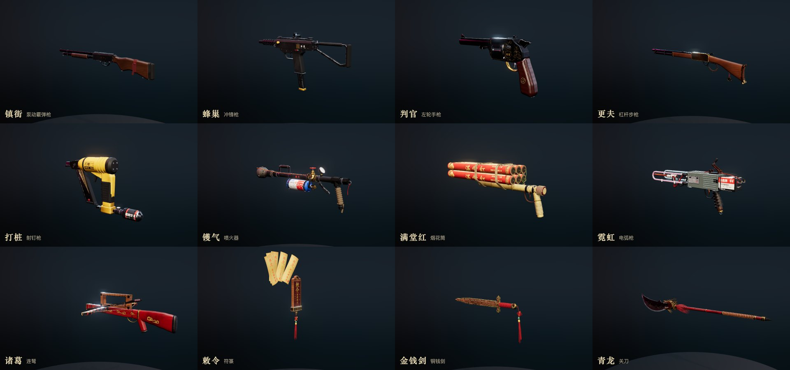
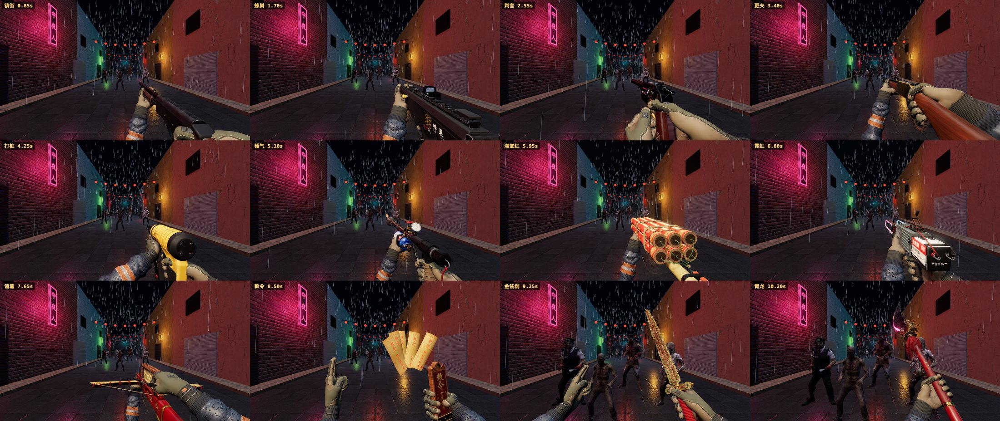
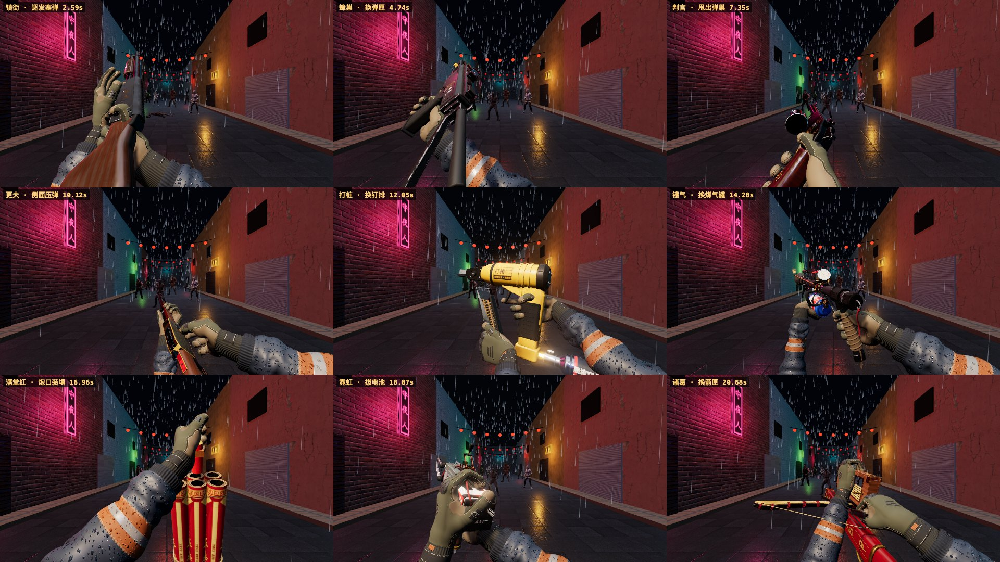
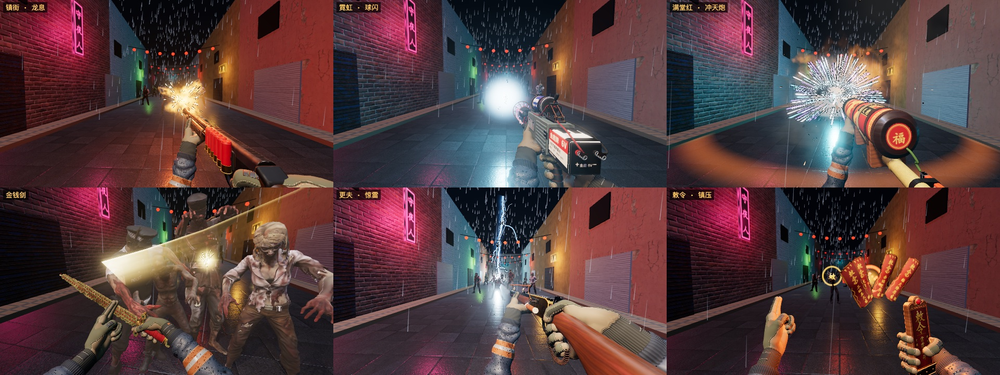

# 鬼市 · 军械试验场

肉鸽（roguelike）武器的试验场：在这里看模型、握法和换弹动作。它可以单独运行——
不引用 `src/game.js`，复用 `public/assets/` 里的僵尸模型和贴图。

**靶场不在这里，在游戏里**：顶部的「靶场 ↗」会带着当前这把武器的形态、等级和调料打开游戏本体的靶场（`/?range=1`）——
真实的街道、僵尸和画面，手感、数值、特效亮度都在那里调。本机开着游戏的开发服务器（`npm run dev`）就开本机的，没开就开线上的；
也可以用 `?game=<地址>` 指定。说明见仓库 README 的「调试」。武器设计见 [docs/weapons-roguelike.md](../docs/weapons-roguelike.md)。

**试验场和游戏本体跑的是同一份规则，改一处两边一起变**（见下面「和本体的关系」）。所以改了这里的战斗和数据模块，
`npm run arsenal:test` 和本体的 `npm run test:e2e` 都要跑。

```sh
npm run arsenal          # http://127.0.0.1:5311/
npm run arsenal:build    # 产物在 arsenal/dist/
npm run arsenal:single   # 单文件展柜 arsenal/dist-single/arsenal-showcase.html（约 1 MB，可直接发到手机上打开）
                         # 游戏的陈列馆（线上的 /gallery/）就是这个展柜：npm run build 时由 scripts/showcase.mjs 生成，多一个「← 首页」
npm run arsenal:test     # 试验场自己的测试：全部形态冒烟 + 真实点击和按键（约 2 分钟，首次运行前 npx playwright install chromium）
node arsenal/scripts/design-doc.mjs   # 改了武器数据或本体的数值表之后重新生成设计文档
node arsenal/scripts/check-data.mjs   # 卡片上的数值和实际开火的数值对不对得上（npm run check 也会跑）
node arsenal/scripts/extract-hands.mjs   # 本体的手（src/game.js）改了之后重新抽取到试验场
```









## 和本体的关系

本体的套餐通过 `src/chinatown/armory.js` 直接导入这里的武器模型、特效、战斗控制器和双手；这里的测试台反过来读本体的数值表。
没有哪条规则写了两遍：

| 内容 | 唯一的出处 |
| --- | --- |
| 每种形态开火做什么，伤害、弹匣、射速、换弹时间 | `src/combat/behaviours.js` |
| 输入、换弹、近战、投掷、范围伤害 | `src/combat/combat.js`（本体用的是同一个控制器） |
| 手感：后坐、镜头上抬、散布扩张、喷射抖动、近战顿挫 | 数字在 `src/data/feel.js`，模型在 `src/combat/recoil.js` |
| 伤害结算、四种状态、四种反应、精英和关底的抗性、附魔调料怎么触发 | `src/combat/status.js`，数字在 `src/data/status.js` |
| 每级的伤害倍率 | `src/data/levels.js` |
| 调料的层数和数值、对武器的作用 | 本体的 `src/chinatown/runtune.js` |
| 四种弹药的上限、每把武器每发吃多少 | 本体的 `src/chinatown/loadout.js`（`AMMO`、`ARMS`） |
| 僵尸的血量、速度、伤害、出手节奏、受击硬直、弱点大小 | 本体的 `src/chinatown/zombietune.js` |
| 调料和弹药的名字 | 本体的 `src/i18n/locales/zh-CN.js` |

这里还留着一条巷子，叫**测试台**（顶部的「测试台」或 `?mode=fp`）：自动测试和测量脚本在里面开火，可以逐帧步进，几秒钟打完六十种形态。
它的规则和数值就是上表这些，和本体是同一份；但僵尸只会直线走过来、命中体积是一根圆柱加一个头、光照是亮巷子，
所以**不要拿它调手感和特效亮度**，那是游戏里的靶场的事。测试台上也能叠调料（右上角「调料」，作用在武器上的八种）、
按套餐结算弹药（「弹药 · 套餐」），给脚本测带调料的数值用。

- **同一组地址参数三处都认**：`?w=flamer&b=a&lv=5&spice=chili:2,fire:3`。在这里是展柜里的这个形态（加 `&mode=fp` 进测试台）；
  换成本体的地址是带着它们开一局；再加 `range=1` 是靶场。
- **数值只写一遍**：基础形态的伤害、弹丸数、射程、溅射、弱点倍率、挥砍范围写在 `src/data/weapons.js` 的 `fire` 里，
  `behaviours.js` 直接读它；射速、弹匣、换弹时间以 `behaviours.js` 的 `spec()` 为准，卡片读它，`scripts/check-data.mjs` 再核对数据里的那份。
  还是手写的只有岔路说明文字里的数字，改岔路的数值时要一起改。

测试台缺什么，就把本体那部分抽成两边共用的代码，不要在这里照抄一份。

## 怎么用

- **展柜**：左边选武器，右边是升级卡片——点等级 1–5、点「甲」「乙」切换岔路，模型跟着换；拖动旋转，滚轮缩放。右上角「升级规则」是等级、元素、反应和铭文的总表。
- **测试台**（顶部标签或 Tab）：点一下画面锁定鼠标，左键开火，右键是该形态的特殊动作（点名、泼油、蓄力、掷刀，屏幕下方有提示），R 换弹，
  1 / 2 / 3 切换基础、甲、乙，− / = 调等级，Q / E 换武器，Esc 释放鼠标后可以点右上角的开关。
- **手机 / 单文件**：单文件版只有展柜（测试台需要僵尸模型和街道贴图，会让文件涨到约 25 MB），默认显示双手；窄屏时武器列表变成顶部横条、
  升级卡片变成底部面板，单指拖动旋转、双指缩放。
- 右上角：每秒伤害、累计伤害、击杀、受伤和耗弹；靶子「站桩 / 逼近 / 尸潮」；「弹药」和「调料」（本体的规则，见上面「和本体的关系」；
  比如给喷火器加一层陈醋看爆燃）。拿近战武器时靶子会自动站近。
- **尸潮**：16 只僵尸从巷子尽头一批批走过来，血量、速度、每下伤害、出手节奏和受击硬直读的就是本体的僵尸数值表，
  走到跟前会打人，屏幕泛红并计入「受伤」。武器数值就是在这个模式下校的，见设计文档的「尸潮下的数值」。
- **声音**：顶部「声音」开关。枪声、换弹的每一下、近战、爆炸、落雷、持续的火焰和电弧声全部是合成的，没有音频文件；浏览器要求先点一下页面才会出声。
  每个声音是 `src/audio/sounds.js` 里的一个生成函数（和游戏本体的声音同一种写法），试验场把它们渲染成缓冲区自己播放，
  游戏把同一批函数并进自己的声音表、走自己的总线，所以两边听到的是同一个声音。

## 文件

| 路径 | 内容 |
| --- | --- |
| `src/data/weapons.js` | 武器、岔路、元素、反应、铭文的设计数据（界面和设计文档都读它） |
| `src/data/levels.js`、`status.js` | 每级的伤害倍率；四种状态和反应的全部数字。本体读的也是这两张表 |
| `src/kit/geo.js` | 建模基元：带圆角的挤出、车削、扫掠、导轨、螺丝；网格合并 |
| `src/kit/mats.js` | 材质库：三向投影的磨损贴图、边缘掉漆、木纹／滚花／布纹等图案 |
| `src/kit/index.js` | 交给武器模型的工具箱：基元 + 材质 + Canvas 贴标 + `kit.weapon()` 包装 |
| `src/kit/hands.js` | 第一人称双手：手指姿势库，把武器的握法换算成本体那双手的目标（手腕位置、手指角度、肩膀）。手肘摆在手腕最省力的地方；托枪的手（左手）还可以在握点上小幅转动来把手腕放直——绕掌心最多 17°、绕握着的东西最多 26°，握法里写 `give: [绕掌心, 绕握把]`（弧度）可以单独改。扣扳机的手不动 |
| `src/kit/fit.js` | 手指自动贴合：手从张开逐节收拢，碰到武器表面为止（开发时在控制台里用，不在每帧里跑） |
| `src/kit/gamehands.gen.js` | 游戏本体的手臂（骨骼、蒙皮网格、材质、关节范围、手臂求解），由 `scripts/extract-hands.mjs` 从 `src/game.js` 生成 |
| `src/weapons/<id>.js` | 每把武器的模型，一个文件一把，含三种形态和可动零件 |
| `src/render/stage.js`、`range.js` | 渲染、后处理、环境光；展柜与雨夜测试台 |
| `src/fx/core.js` | 特效运行时：粒子、拖尾与闪电、贴花、光源池、弹壳、镜头震动。粒子可以带 `trail: { rate, life, size }`，飞行中沿路甩下火星（快的时候首尾相接成线，慢下来变成闪烁的点）；同时烧的东西多了、或者在低画质档，火星会自动变稀 |
| `src/fx/effects.js` | 具名特效：枪口焰、曳光、命中、爆炸、烟花、火焰喷射、落雷、符咒、火池等。烟花是按礼花弹的样子做的：星均匀抛出、被空气拖住停在半径附近、被重力拉弯、带着拖尾落到地上弹起。`blood` 是受击溅血（命中占血量越多喷得越多），`gore` 是击杀时的暴血（血雾、喷溅、碎块、地上的血迹）；血的亮度同样按游戏的夜街定 |
| `src/fx/limbs.js` | 断肢：按骨骼权重把头、前臂、整条手臂、小腿、整条腿从僵尸模型里切出来（每种模型切一次），断掉的那截带着断口飞出去、翻滚、落地、留在地上一会儿；身上留一个带骨茬的断口，跟着骨骼动。本体和测试台用的是同一份 |
| `src/combat/behaviours.js` | 每把武器每种形态开火时做什么（弹道、伤害、状态、特效编排） |
| `src/combat/combat.js` | 战斗控制器（测试台和本体共用）：输入、弹药与换弹、近战挥砍、投掷、范围伤害；`setMods()` 接调料倍率，`lab.supply` 决定换弹从哪里拿子弹。子弹从眼睛出发，天然在准星上；从枪口飞出去的东西（弩箭、钉子、烟花、符纸、电球）一律用 `ctx.launch(枪口, 速度, …)` 取初速，它朝准星所指的那个点飞，并把 30 米内的下坠补上——不要再写「准星方向 × 速度」，那样会和视线平行、偏出一个枪口的距离 |
| `src/combat/recoil.js`、`src/data/feel.js` | 手感。每把武器一组数：一发子弹让枪后坐多少、枪口上跳多少、往哪边歪、镜头抬多少、其中多少留在准星上要自己压回来、连射时准星张开多少；喷射类握着时怎么抖；近战砍中时停多久、镜头怎么跟。做法和原版两把枪一样（冲量打在阻尼弹簧上，枪绕握把转而不是绕眼睛转）。行为里的 `ctx.kick(a)` 只说这一下有多重，`a` 相对于表里的 `ref` 缩放。`node arsenal/scripts/feel-report.mjs` 把表里的数字换算成度、毫米和毫秒 |
| `src/combat/status.js` | 两边共用的规则：伤害结算、四种状态、元素反应、附魔调料。测试台和本体各自只提供僵尸 |
| `src/combat/fate.js` | 击杀之后尸体怎么样，也是两边共用的规则：会不会被打飞、飞多远、流多少血、掉哪几截肢体、头是不是直接炸开。打飞的力度和出血量都按这一下打掉的血量占比算，再掷一次骰子，所以每次不一样（同一瞬间落在身上的霰弹算一下）。纯函数，数字在 `data/status.js` 的 `launch`、`blood` 和 `sever` |
| `src/combat/meal.js` | 测试台这边的「套餐」：按本体的表管调料层数和四种弹药池，再通过 `setMods()`、`setInfusions()`、`lab.supply` 作用到武器上 |
| `src/combat/projectiles.js` | 飞行弹体：钉子、弩箭、铜钱、符纸、烟花、油、剑气 |
| `src/combat/targets.js` | 测试台的僵尸靶：模型和动作、站桩 / 逼近 / 尸潮、命中体积。数值读本体的 `zombietune.js`，规则在 `status.js` |
| `src/audio/sounds.js` | 每个声音怎么合成：枪声（照本体两把枪的做法：三段噪声、压力脉冲、下滑的低频、饱和、随时间收拢的低通，再叠上机件声）、钉枪、烟花、弩、符、近战、换弹动作、街上的爆炸与落雷、火焰和电弧的循环声；还有每把武器开火用哪个声音的表 `SHOTS` |
| `src/audio/dsp.js` | 合成用的信号工具（噪声、滤波、包络、共振、敲击、气流、无缝循环），纯函数，node 里也能跑 |
| `src/audio/audio.js` | 播放：试验场自己的图（压缩器、巷子混响）；传入 `host`（游戏的声音系统）时改走游戏的总线 |
| `src/ui/` | 界面与测试台 HUD |
| `scripts/design-doc.mjs` | 从设计数据和本体的数值表生成 `docs/weapons-roguelike.md` |
| `scripts/check-data.mjs` | 核对卡片上的基础数值和实际开火的数值、武器在本体的弹药表里是否齐全 |
| `scripts/single.mjs` | 生成单文件展柜 |
| `scripts/showcase.mjs` | 把展柜做成一个自带全部代码的页面。单文件展柜和游戏的陈列馆（`dist/gallery/`，由本体的 `vite.config.js` 在构建时调用）都用它；给了 `home`（游戏在哪）就多出回首页的链接，「靶场 ↗」也改成去那个游戏 |
| `scripts/extract-hands.mjs` | 从本体的打包文件里抽出手部模块（解析后按引用关系取出需要的声明），本体代码不改 |
| `scripts/balance.json` | 尸潮测试的结果，设计文档里的数值表读它（由 `tools/balance.mjs --write` 更新） |
| `tests/`、`playwright.config.js` | 试验场的 Playwright 测试，见下面「测试与工具」 |
| `tools/` | 测量和出图脚本，见下面「测试与工具」 |

## 检查与脚本控制

- 地址参数：`/?w=<id>&b=base|a|b&lv=1..5&mode=show|fp&yaw=&pitch=&dist=&ui=0`，以及 `spice=chili:2,fire:3`（调料和层数）、`ammo=meal`（按套餐结算弹药）。
- `window.__lab`：`select(id)`、`setBranch(b)`、`setLevel(n)`、`setMode("fp")`；`window.__errors` 收集运行错误。
- 测试台：`__lab.combat.press("fire" | "alt")`、`release(...)`、`aimAt(僵尸序号)`、`targets.setMode("stand" | "advance" | "horde")`；
  `__lab.combat.meter` 里有累计伤害、击杀、受伤和打掉的发数（`spent`），`resetMeter()` 清零。
- 套餐：`__lab.meal.set("vinegar", 2)`（调料层数，0 去掉）、`clear()`、`setAmmo("meal" | "free")`、`refill()`；`__lab.meal.pool` 是四种弹药池。
  `__lab.combat.mods` 是当前的伤害、射速、换弹倍率，`__lab.combat.targets.rules.infusions` 是生效的附魔。
- 声音：`__lab.audio.measure("magIn")` 渲染一个声音并返回峰值和响度，用来在没有扬声器的环境里检查它确实有内容；
  `node arsenal/scripts/sounds.mjs [名字的一部分]` 把每个声音量成一行数字（衰减时间、密度、重心、各频段的能量占比）。
  没人能听的时候靠它调：本体步枪的密度（crest）约 3 dB，频段占比约 15/45/33/7/1；
  低于 120 Hz 的占比过高的声音在手机喇叭上等于没有。
- 看手：Dash 会在展柜里转着看手和手臂。托枪的手要斜托（手指与枪管成 50–55°、拇指顺枪管）；改握法后用 `tools/fit-grip.mjs` 重算、
  跑 `tools/arms.mjs`，从后方、左侧、上方都看过再交付。本体的检视页：`?show=hands&hview=back|palm|arm|fp`、
  `?show=weapon&wpose=hip|hands|reload&wt=<秒>&wgun=pistol`。给 Dash 看手时直接附截图，或者附 `npm run arsenal:single` 的单文件展柜（可以发到手机上看）。
- 逐帧步进（抓枪口焰这类几十毫秒的瞬间）：`__lab.manual = true` 之后用 `__lab.advance(秒)` 推进时间并渲染一帧。
- 开发服务器关掉了热重载，改完文件刷新页面即可；新增武器文件后需要重启服务器。
- 特效亮度的经验：加色混合的粒子叠在一起很快就过曝成白色，ACES 色调映射还会把带蓝分量的亮色洗白。火焰的颜色用线性值直接给（见 `effects.js` 的 `PAL`），
  单个粒子的亮度控制在 1–3；光源不要贴着枪管放。火星、烟花的星这类很小的亮点例外（6–8）：游戏的夜街会再压掉七成
  （`ARMORY_TUNE.fxGain`），它们的亮度要在游戏的靶场里看，不要按测试台定。

## 测试与工具

`npm run arsenal:test` 跑 `tests/` 里的两组 Playwright 测试（对着构建产物，端口 5312，和本体的测试互不相干；CI 在本体的冒烟测试之后也会跑）：

- `smoke.spec.js`：12 把武器 × 5 种形态各开火、用特殊动作、再开火，不许报错，每种形态都必须打出伤害。
- `rules.spec.js`：测试台确实在按本体的表走——僵尸的血量和速度、等级和调料对伤害、射速、换弹的作用、附魔调料在第几次命中触发、
  按套餐结算时一次换弹从弹药池里扣多少、池子空了换不了弹。
- `sever.spec.js`：断肢的规则（爆炸、刀、打飞、爆头各掉什么，精英和关底不掉），以及测试台上断下来的那截确实在、重生后是完整的。
- `input.spec.js`：用真实鼠标点击和按键走一遍——展柜选武器、点等级和岔路、拖动旋转；测试台左右键、`R`、`Q`/`E`、数字键；
  「双手」「演示动作」「声音」「尸潮」「调料」「弹药」；九把枪按 `R` 换弹并按顺序听到各自的换弹声；手机宽度下顶栏每个按钮都点得到。
  点击前先确认按钮没有被别的元素盖住。

`tools/` 里是测量和出图的脚本，直接用 node 跑；试验场开着（`npm run arsenal`）就用开着的，没开会自己起一个。

| 脚本 | 用途 |
| --- | --- |
| `tools/balance.mjs` | 尸潮下的数值：机器人用每种形态各打一段时间，输出每分钟击杀、伤害和受伤。`--write` 更新 `scripts/balance.json`，再重新生成设计文档 |
| `tools/leak.mjs` | 泄漏和帧耗：每种形态反复打三轮，比较显存里的几何体和贴图、场景对象数、JS 堆，以及每帧逻辑耗时 |
| `tools/arms.mjs` | 手腕弯了多少度、超出活动范围多少（弧度）：持握时，以及开火、特殊动作、换弹过程中最糟的一刻 |
| `tools/shots.mjs` | 出图：`show` 是展柜多角度拼图（可以停在换弹的某一刻、镜头对准某只手），`play` 是第一人称逐帧序列 |
| `tools/fit-grip.mjs` | 给一个握点算手指角度（手指收拢到碰到武器为止），打印可以直接贴进武器文件的握法，并报告手腕姿势 |

每个脚本开头有用法。改了握法至少跑 `arms.mjs` 并用 `shots.mjs` 从后方、侧面、上方各看一眼，不要只看第一人称。

## 写一把武器

模型文件默认导出 `build(kit)`，返回 `kit.weapon({...})`。`src/weapons/shotgun.js` 是参考实现。

**坐标**：枪身空间 `+Z` 指向枪口，`+Y` 向上，`+X` 是射手的左手边；单位米；原点在扳机（近战武器在握持点，`+Z` 指向刀尖）。

**基元**（都返回带 `position / normal / uv / color / aWear` 的几何体）

- `prism(pts, depth, { plane, bevel, bevelSeg, holes })`：把二维轮廓挤出。`plane: "side"`（默认）轮廓是 `[z, y]` 侧视图，沿 X 挤出；
  `"front"` 轮廓是 `[x, y]` 截面，沿 Z 挤出；`"top"` 轮廓是 `[x, z]`，沿 Y 挤出。点的第三个数是该拐角的圆角半径。
  `bevel` 是侧壁与两个端面之间的倒角，`bevelSeg: 4` 配大倒角可以做出枪托、握把这类椭圆截面。
- `box(w, h, d, { bevel, r })`、`lathe([[z, 半径, 圆角?]...], { seg, flat, arc, squash })`、`rod(r, z0, z1)`、`tube(rOut, rIn, z0, z1)`、
  `cone(r0, r1, z0, z1)`：绕 Z 轴的回转体；`flat: true` 做六角／八角。
- `sweep(points, r)`：沿路径的圆管（线缆、软管、绳）；`helix(R, wire, z0, z1, turns)`：线圈、弹簧、缠绳。
- `sphere`、`torus`、`rail(z0, z1)`（皮卡汀尼导轨，顶面在 y=0）、`screw(r, { axis, hex })`。
- `adopt(threeGeometry)`：把任意 THREE 几何体转成同样的属性布局。

**装配**：`const m = kit.M(); m.add(geo, "材质名", { at, rot, scale, color, wear, mirror }); const node = m.build("名字")`。
一个 `M()` 按材质合并成几个网格；需要单独运动的零件（套筒、泵、弹巢）各用一个 `M()`。`mirror: true` 同时加一份左右镜像。
小零件整体都是“边缘”，会被磨得发白，给它们 `wear: 0.2~0.4`。

**材质**：`kit.mats.names()` 列出全部。常用：`steel_blued` `steel_park` `steel_bare` `steel_dark` `iron_cast` `iron_rust` `chrome`
`brass` `brass_aged` `copper` `bronze` `gold` `coin` `polymer` `polymer_grip` `polymer_yellow` `rubber` `wood_walnut` `wood_rose` `wood_peach`
`wood_dark` `bamboo` `lacquer_red` `lacquer_black` `paint_red|blue|green|yellow|grey` `enamel_white` `cloth_red` `cloth_black` `cord_red`
`cord_gold` `rope_hemp` `leather` `tape_black` `paper_yellow` `paper_red` `paper_kraft` `ceramic` `jade` `agate_red` `bore`。
`kit.mats.variant("paint_red", { color: 0x224488 })` 做一次性变体；`kit.mats.glow(color, power)` 是自发光（霓虹、烧红的金属、发光符文，
`power` 3 以上会有辉光）；`kit.mats.glass(color)` 是玻璃。

**文字和图案**：`kit.label({ key, w, h, px, face, at, draw(g, W, H), metal, rough, glow })` 在某个面上贴一张 Canvas 画的标签
（`face`: `"x"` 左侧、`"-x"` 右侧、`"y"` 顶面…，文字对着看的人总是正的）；`kit.wrap({ r, z0, z1, draw })` 把图案卷在圆筒上。
中文字体用 `kit.FONT_KAI`（楷体）或 `kit.FONT_SONG`。

**岔路**：`kit.only(node, "a")` 让节点只在甲形态出现，`"base,a"` 表示基础和甲都出现。被替换掉的原件标 `"base"`。

**双手**（`src/kit/hands.js`）：用的就是游戏本体的那双手——战术手套、裸露的手臂（主角是女生）、35 根骨骼、从肩膀算起的手臂求解，
由 `scripts/extract-hands.mjs` 从 `src/game.js` 原样抽到 `src/kit/gamehands.gen.js`（生成文件，不要手改；本体的手改了就重新跑一遍脚本）。
`hands.js` 只负责把武器的握法描述换算成这双手的目标。武器不用管骨骼，只描述“怎么握”——

```js
hands: {
  right: { at: [x, y, z], palm: [x, y, z], fingers: [x, y, z], pose: "pistol", trigger: true },
  left:  { parent: pump, at: [...], palm: [...], fingers: [...], pose: { base: "wrap", r: 0.027 } },
},
// 岔路之间握法不同就写成函数： hands: (branch) => ({ right: {...}, left: branch === "a" ? {...} : {...} })
```

- `at`：掌心贴在武器上的那一点（枪身空间）；`palm`：掌心朝哪边（指向武器）；`fingers`：手指伸直时指向哪边。
  三个量就定下了整只手，拇指在哪一侧随之而定（右手拇指侧 = `fingers × palm`，左手相反）。
  握一根半径 R 的柄时，`at` 取柄的轴心沿 `-palm` 方向退 R 的那一点。
- `pose`：`"pistol"`（三指握把、食指搭扳机）、`"cradle"`（托护木）、`"wrap"` 或 `{ base: "wrap", r: 握柄半径 }`、`"fist"`、`"pinch"`、
  `"sword"`（剑指）、`"point"`、`"flat"`、`"relax"`。可以逐指覆盖：`{ base: "pistol", thumb: [dx, dy, dz, 关节, 指尖], index: [指根, 中节, 末节, 张开] }`
  （手指角度是弧度，0 伸直、约 1.5 握到底；拇指前三个数是第一节的朝向，按右手的手部空间给：+X 拇指侧、-Y 掌心外、+Z 指尖方向，左手自动镜像）。
- `trigger: true`：食指跟着扳机动。`parent: 节点`：手跟着这个零件走（泵、杠杆、拉机柄）。
- **托枪的手要斜着托**：护木、泵这类横在掌心里的东西，手指方向别垂直于枪管，朝枪口偏过去（和枪管成 50–55°），
  这样手和从后下方来的前臂在一条线上，手腕是直的；拇指顺着枪管贴在左侧。垂直横握时手腕会被折成直角。
- **手指角度可以自动算**：页面上打开武器和「双手」，在控制台里 `await __lab.fitGrip("left")`，手指会从张开逐节收拢到碰到武器表面为止，
  返回可以直接贴进 `pose` 的角度；想先试别的握点或方向就传 `{ at, palm, fingers }`，握柄用 `{ kind: "wrap" }`。镇街、蜂巢、更夫托枪的手就是这样定的。
  命令行里用 `node arsenal/tools/fit-grip.mjs <武器> <形态> left 图.png --phi 55`，同时出六个角度的图。
- **手臂不用管**：肩膀在眼睛下方两侧（和本体一致），手肘默认朝外下方，前臂自然从画面下角进来；武器离得比手臂长时肩膀会跟着前探。
  手肘会绕着肩膀到手腕的连线转到手腕最省力的位置（手腕弯得越多代价越大，不只是超出活动范围才算），
  托枪的手还会在握点上小幅转动把手腕放直，所以握点只管手贴在哪、朝哪，不用为了手腕去凑角度。
  手腕只能弯到一定角度，握点的朝向别让手背折向前臂。关节有活动范围（指根 -0.45~1.6、中节 0~1.95、末节 -0.1~1.45、张开 -0.3~0.4），
  写出界的角度会被夹回去；拇指的朝向只能落在它够得到的范围里（大致从贴着食指到横过掌心）。
- **第二握点**：握点可以带 `alts: { mag: { parent: 弹匣节点, at, palm, fingers, pose }, bolt: {...} }`。在 `update()` 里设
  `model.grips.left.to = "mag"; model.grips.left.mix = 0..1`，手就从主握点平滑移到第二握点；第二握点挂在会动的零件上
  （弹匣、正在装的那发子弹、拉机柄），零件怎么动，手就怎么跟。
- **专属换弹**：武器声明 `ownReload: true` 后自己负责换弹动画（零件和双手），试验场不再自动让托枪的手离开。
  用 `s.reload`（0→1，不在换弹时为 -1）和 `s.reloadTime`（秒）编排；`view.reload = { pos, rot }` 指定换弹时枪在视野里怎么偏，
  可选的 `span: [进入完成, 开始回正, 回正完成]`（换弹进度的分数）让枪在手回到握点之前先回正，免得前臂横在画面里。
- **卡点与声音**：`s.prev.reload / cycle / swing / charge` 是上一帧的值，`if (s.prev.reload < 0.6 && s.reload >= 0.6) s.cue("magIn")`
  就在弹匣到位的那一帧出声。可用的声音名见 `src/audio/audio.js` 的 `CUES`，各自的做法在 `src/audio/sounds.js` 的 `CUE_DEFS`。
- 展柜顶部「演示动作」会播放一次开火和一次换弹；`__lab.freeze({ reload: 0.4 })` 把动画停在某一刻方便检查。
- 没有这只手就写 `null`。武器的 `update()` 里可以改 `model.grips.left.away`（0→1 松手离开）、`.pose`，或直接动 `.anchor`。
- 换弹时托枪的手会自动松开再回来；武器被掷出时双手自动放下。
- 看握得对不对：`/?w=<id>&hands=1`（展柜里也显示双手），界面顶部也有「双手」开关。

**`kit.weapon({ id, root, anchors, update, view, show })`**

- `anchors`：特效挂点，值是 `[x, y, z]`、按岔路区分的 `{ base, a, b }`，或挂在运动零件上的 `{ parent: node, at }`。
  枪类必须有 `muzzle`，抛壳的有 `eject`；多管武器用 `m0, m1, …`；近战武器用 `base` 和 `tip`（刃的两端，拖尾用）。
- `update(s, dt)`：每帧驱动运动零件。`s` 的字段：`t` 时间；`shot` 距上次开火的秒数；`shots` 累计开火次数；
  `cycle` 开火后机构动作的进度 0→1（闲置时为 1）；`trigger` 扳机 0..1；`firing` 是否在持续喷射；`heat` 0..1 连续开火的热量；
  `charge` 0..1 蓄力；`rounds` / `mag` 弹匣余量与容量；`reload` 换弹进度 0→1（不在换弹时为 -1）；`swing` 近战挥砍进度 0→1（闲置为 -1）；
  `branch`、`level`。
- `view.hip = { pos: [x, y, z], rot: [俯仰, 偏航, 滚转] }`：第一人称里枪身原点在相机空间的位置（x 右、y 上、-z 前）和姿态。
- `show = { yaw, pitch, dist }`：展柜的默认机位。

写完后在展柜和测试台各看一遍三种形态，再到游戏的靶场（`/?range=1&w=<id>`）里拿着打一遍；可动零件用 `__lab.manual` 步进到动作中途检查。
